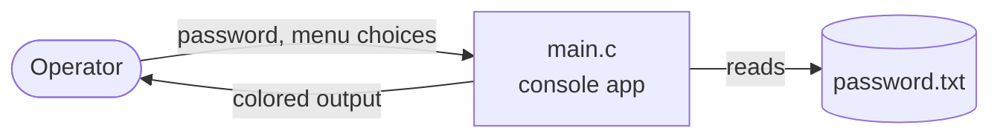

# Student CA Evaluation System: High-Level Design

A password-protected, menu-driven C console program that manages student records (add, list, search, edit, delete) in memory. For code-level detail see the [Low-Level Design](lld.md).

## 1. Context

## 2. Features

| Feature | Detail |
|---|---|
| Login | Password compared with the first line of the password file |
| Records | first and last name, registration number, total marks, marks obtained |
| Operations | Add, list / display, search, modify, delete, exit |
| Validation | Duplicate registration number rejected; field checks on entry |
| Capacity | Up to 100 records, held in an array of structs |
| Output | Colored text through `color.h` |

## 3. Tech

| Item | Choice |
|---|---|
| Language | C (`stdio.h`, `string.h`) |
| Storage | In memory only; records are lost on exit |
| Build | `gcc main.c -o app` |
