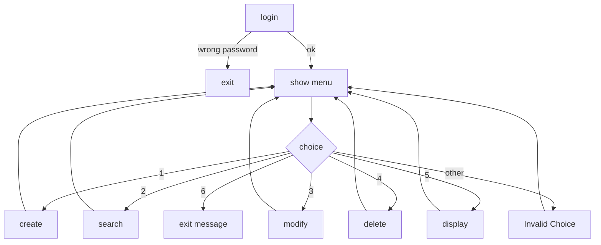

# Student CA Evaluation System: Low-Level Design

For the big picture see the [High-Level Design](hld.md).

## 1. Data

```c
typedef struct ca_evaluation {
    char first_name[20];
    char last_name[20];
    int reg_no;
    float total_marks;
    float marks;
} CA;   // array of MAX_STUDENTS (100)
```

## 2. Functions

| Function | Behavior |
|---|---|
| `login(int *Verify)` | Reads a password, compares with the first line of `Password.txt`, sets `*Verify = 1` on match |
| `create(CA *Stud, int *numstud)` | Rejects when full or when `reg_no` already exists; checks `0 ≤ marks ≤ total_marks` |
| `display(CA *Stud, int numstud)` | Table of all records |
| `search(CA *Stud, int numstud)` | Finds by registration number |
| `modify(CA *Stud, int numstud)` | Edits a record found by registration number |
| `del(CA *Stud, int *numstud)` | Removes a record and shifts the rest left |

## 3. Menu loop



## 4. Known issues

| Issue | Fix |
|---|---|
| Code opens `Password.txt` but the file is `password.txt` (fails on case-sensitive systems like Linux) | Use one spelling |
| `scanf("%s", &password)` passes the array address with `&` | Use `scanf("%14s", password)` |
